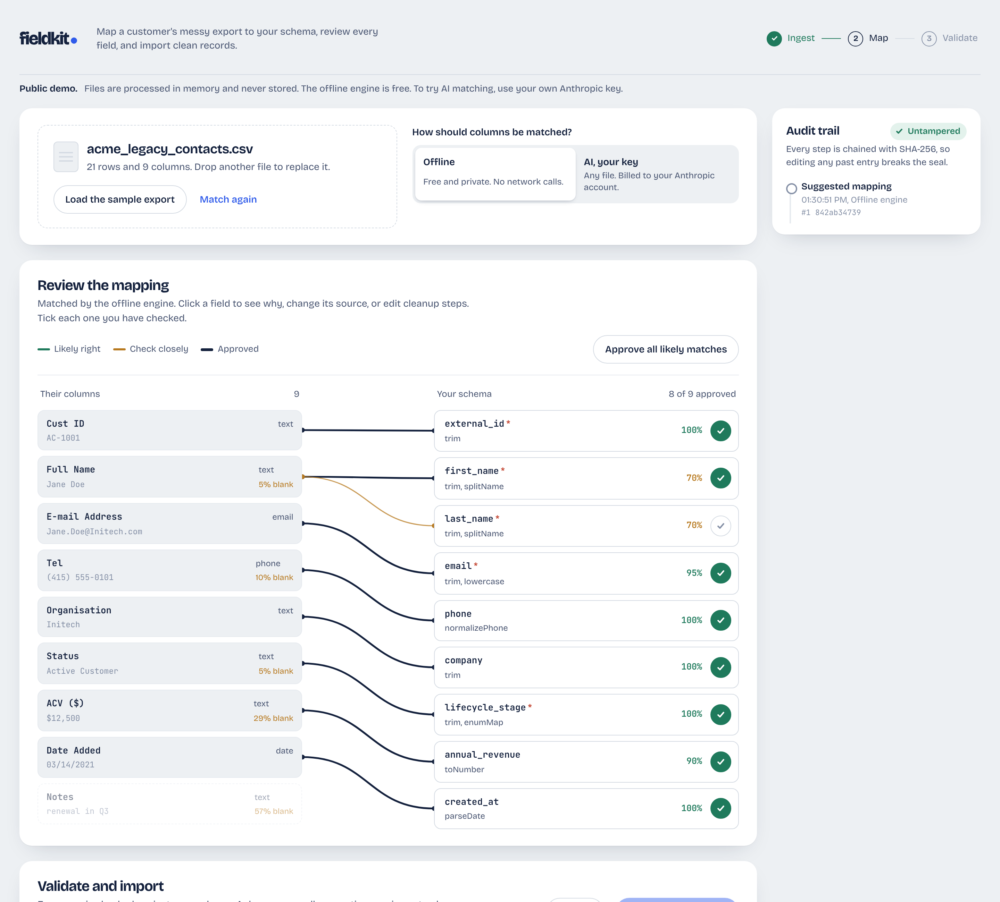
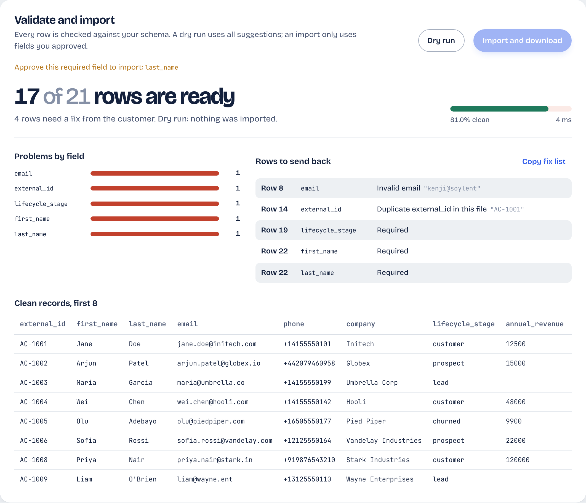
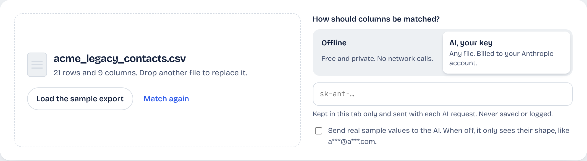

# fieldkit

**Onboard a customer's messy data export in an afternoon, not a sprint.**
AI proposes the mapping · a human approves it · the schema enforces it · every step is audited.



<details><summary>Dry-run results with a copyable fix list for the customer</summary>


</details>

---

## The problem

Every B2B product has the same hidden bottleneck between "contract signed" and "customer live":
**getting the customer's data in.** The export from their legacy CRM has `Cust ID`, `Full Name`,
`Tel` with extensions, four date formats, `"$12,500"` next to `"15k"`, a status column with 12
values your product has never heard of, and the same row exported twice.

Forward Deployed Engineers solve this by hand, per customer, in throwaway scripts. It's slow,
it isn't reviewable, and when it breaks on row 40,000 nobody can say who decided `Inactive` means `churned`.

## What Fieldkit does

| Step | What happens | Why it matters in the field |
|---|---|---|
| **Profile** | Infers types, fill rates, cardinality, and enum-like columns from a sample | You see the data's real shape before you write a line of code |
| **Suggest** | Proposes column→field mappings and cleanup transforms (LLM, or an offline heuristic fallback) | 9/9 fields auto-mapped on the sample export, including full-name splitting and a 12-value enum map |
| **Review** | A person approves each field; a real run is **blocked** until every required field is approved | The AI never ships a mapping unreviewed |
| **Dry run** | Every row is validated against the product's schema; errors are reported **by spreadsheet row number** | You send the customer "fix rows 8, 14, 19, 22", not a stack trace |
| **Run** | Emits clean, deduplicated, idempotent records (JSONL → your product's import API) | Safe to re-run |
| **Audit** | Append-only, SHA-256 hash-chained log of who suggested, approved, and ran what | Answers the security review questionnaire |

It ships as **a web workbench** (Next.js) for working sessions with the customer, and **a CLI** that
runs the same engine headless inside the customer's VPC, on-prem, or air-gapped.

## Quick start

```bash
pnpm install
pnpm test                 # 29 tests: engine (transforms, mapping, guardrails, pipeline, audit) + demo-mode policy
pnpm dev                  # http://localhost:3000, then "Load the sample export"
```

CLI walkthrough:

```bash
cd packages/cli
alias fieldkit="npx tsx src/index.ts"
fieldkit profile --source ../../examples/acme_legacy_contacts.csv
fieldkit suggest --source ../../examples/acme_legacy_contacts.csv --out mapping.json
fieldkit run     --source ../../examples/acme_legacy_contacts.csv --mapping mapping.json   # ✘ refused: not approved
fieldkit approve --mapping mapping.json --all
fieldkit run     --source ../../examples/acme_legacy_contacts.csv --mapping mapping.json   # ✔ 17 valid, 4 flagged
fieldkit audit verify
```

LLM-assisted mapping is optional: `export ANTHROPIC_API_KEY=...` for local or private runs (it's ignored in public demo mode). Without a key, Fieldkit uses the
deterministic heuristic mapper and **says so in the UI**. It never falls back silently.

Docker: `docker build -t fieldkit . && docker run -p 3000:3000 fieldkit`

## Deploy a public demo (safely)

The public demo never spends the owner's API key. In **demo mode** (`FIELDKIT_DEMO_MODE=1`) visitors get two engines:



- **Offline heuristic:** free and the default. It maps 9/9 fields on the sample.
- **AI · your own key:** visitors paste *their own* Anthropic key to try AI-assisted mapping on any file, at their own cost.
  The key stays in tab memory, is sent only as a request header, and is never stored, logged, or written to the audit trail.

Demo mode **ignores `ANTHROPIC_API_KEY` even if it's set** (it logs a warning), so a key added to the hosting dashboard
by mistake can't be billed. Rate limits and upload caps still protect the server.
Details and tradeoffs: [ADR-0005](docs/adr/0005-public-demo-cost-controls.md).

### Vercel (recommended: no cold starts)

1. Import the repo → set **Root Directory** to `apps/web` (framework: Next.js; pnpm is auto-detected).
2. Environment variables: `FIELDKIT_DEMO_MODE=1` and `FIELDKIT_VISITOR_SALT=<random>`. **Don't add `ANTHROPIC_API_KEY`.**
3. Deploy. The audit log automatically uses `/tmp` on Vercel, which resets when instances recycle (the UI says so).

### Render / Fly / any container host

`docker build` uses the included Dockerfile. Mount a volume at `/data` to keep the audit log. On Render's
free tier the service sleeps after 15 idle minutes and takes about a minute to wake, which hurts the first
impression for a recruiter clicking your link. Use a paid instance if you go this way.

## Engineering decisions worth discussing

The full reasoning is in [`docs/adr/`](docs/adr). The short version:

1. **The LLM proposes; it never decides.** Its output is zod-validated. Columns it invents are
   rejected one field at a time and replaced with the heuristic answer. Nothing is auto-approved, and
   the target schema validates every row regardless. → [ADR-0001](docs/adr/0001-llm-proposes-human-approves.md)
2. **Transforms are a closed, serialisable DSL, not generated code.** A mapping is a JSON file you
   can diff, review in a PR, and replay. There is no `eval` on customer premises. → [ADR-0002](docs/adr/0002-closed-transform-dsl.md)
3. **Offline first.** The heuristic mapper needs no network access, and real sample values are masked
   by default before anything is sent to a model (`jane@acme.com` → `a***@a***.a***`). → [ADR-0003](docs/adr/0003-offline-first-pii-masking.md)
4. **Fail before row 1, not at row 40,000.** Preflight checks for unapproved required fields and
   **source schema drift**: if the customer renames a column next month, the fingerprint changes and
   the run refuses to start. → [ADR-0004](docs/adr/0004-preflight-and-drift-detection.md)

## Repository layout

```
packages/core     Engine: connectors (CSV, paginated REST w/ retry), profiling, mappers, transforms, pipeline, audit
packages/cli      Headless runner for customer environments
apps/web          Next.js 15 workbench (App Router, route handlers on the Node runtime)
examples/         A realistically messy legacy-CRM export
docs/             Architecture, ADRs, demo script
```

See [docs/ARCHITECTURE.md](docs/ARCHITECTURE.md) for the data flow and extension points (new
connector = one class; new target = one zod schema).

## Roadmap (what I'd build next with a customer)

- [ ] Sinks: idempotent upsert to the product's REST API with rate limiting and a dead-letter queue
- [ ] Generate target schemas from the product's OpenAPI spec so the tool can't drift from the API
- [ ] Mapping evals: a golden set of real-world exports, tracking LLM vs. heuristic accuracy per release
- [ ] Streaming for 10M+ rows (the connector contract is already `AsyncIterable` batches)
- [ ] Connectors: Salesforce, HubSpot, Postgres, SFTP drops
- [ ] Multi-tenant workspaces + SSO; the audit log moves to append-only Postgres

## License

MIT
