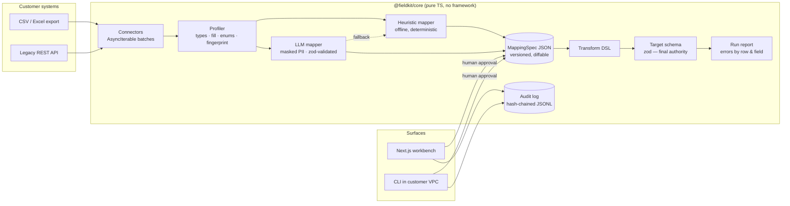

# Architecture

## Trust boundaries

| Boundary | Control |
|---|---|
| Customer data → LLM | Only column names, inferred types, and **masked** samples by default. Raw samples need an explicit opt-in. Low-cardinality enum values are sent because they're needed for the enum map; document this in the DPA. |
| LLM output → mapping | zod schema validation; hallucinated columns rejected per field; transforms are limited to the closed DSL. |
| Mapping → real run | Every required field must be human-approved; the source fingerprint must match. |
| Record → output | The target zod schema validates every row. Invalid rows are reported, never coerced. |
| Public internet → owner's API key | Demo mode ignores the server key entirely: AI is bring-your-own-key only. Optional opt-in adds sample-only, cache, quotas and a spend cap ([ADR-0005](adr/0005-public-demo-cost-controls.md)). |

## Extension points

**New customer system:** implement `Connector` (one method, `extract(): AsyncIterable<RawRecord[]>`).
`HttpConnector` already handles pagination, `Retry-After`, and exponential backoff.

**New product entity:** `registerTarget({ id, fields, validator })`. Field `aliases` feed the heuristic mapper;
the zod `validator` is the contract. In production, generate it from the product's OpenAPI spec.

**New transform:** add a variant to `TransformSchema` and a case in `applyTransforms`. TypeScript's
exhaustive discriminated union means the compiler flags every place that needs updating.

## Scaling notes

- Profiling samples 500 rows, so cost is constant regardless of file size.
- The pipeline is a pure function per record, so it's trivially parallelisable. Next step: stream
  batches from the connector straight through the pipeline to a sink, keeping memory bounded.
- The web app caps uploads at 10MB on purpose. Large or recurring loads belong in the CLI or a job runner.
